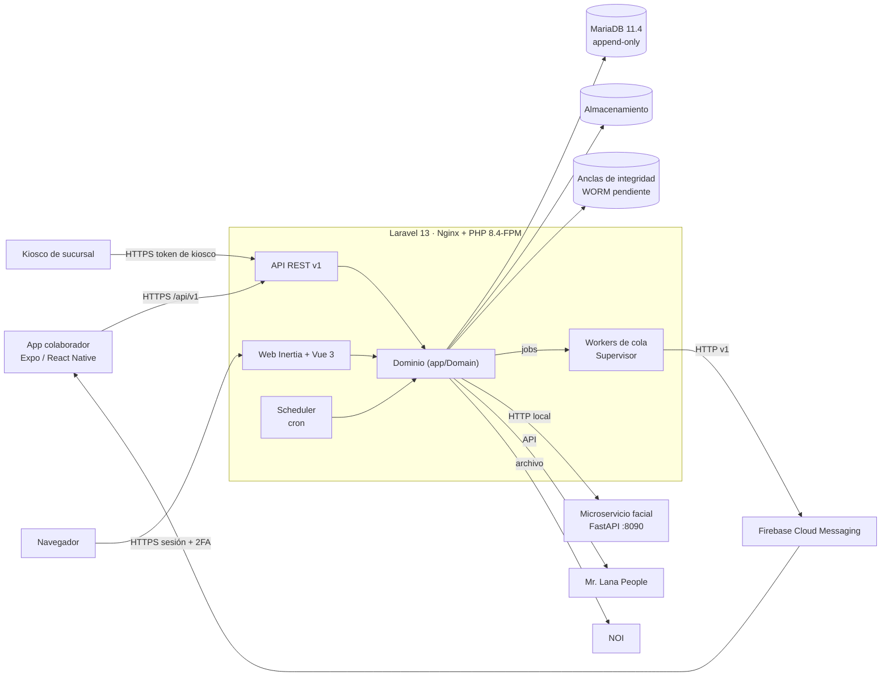

# MR LANA Asistencias

Sistema de registro electrónico de jornada, asistencias y cumplimiento laboral de **PRODUCTOS Y SERVICIOS MR LANA, S.A.P.I. de C.V.** (nombre comercial «Mr. Lana»). Incluye la web de administración (`asistencias.mr-lana.com`), la API REST y la app móvil de colaboradores con modo kiosco de sucursal.

> El nombre definitivo del sistema está pendiente de RH. Este repositorio implementa reglas laborales verificadas en fuentes oficiales, pero no es asesoría jurídica: los puntos marcados «requiere criterio jurídico» en [la matriz legal](docs/legal/MATRIZ_CUMPLIMIENTO.md) deben validarse con el área Jurídica.

## Contenido

- [Objetivo y alcance](#objetivo-y-alcance)
- [Características](#características)
- [Arquitectura](#arquitectura)
- [Tecnologías](#tecnologías)
- [Estructura del repositorio](#estructura-del-repositorio)
- [Instalación local](#instalación-local)
- [Configuración (.env)](#configuración-env)
- [Ejecución](#ejecución)
- [App móvil: Android, iOS y builds](#app-móvil-android-ios-y-builds)
- [Integraciones y servicios](#integraciones-y-servicios)
- [Colas, scheduler y almacenamiento](#colas-scheduler-y-almacenamiento)
- [Pruebas y calidad](#pruebas-y-calidad)
- [Producción](#producción)
- [Seguridad](#seguridad)
- [Solución de problemas](#solución-de-problemas)
- [Limitaciones y dependencias externas](#limitaciones-y-dependencias-externas)
- [Estado real](#estado-real)
- [Referencias](#referencias)

## Objetivo y alcance

**Objetivo empresarial.** Cumplir la obligación de registrar electrónicamente el inicio y fin de la jornada de cada persona trabajadora (LFT art. 132 fr. XXXIV, reforma DOF 1-may-2026; disposiciones de la STPS desde el 1-ene-2027), con un registro que pueda hacer **prueba plena**: inalterable, acordado con el colaborador, completo y disponible para la autoridad en cualquier momento. Además, controlar la reducción gradual de la jornada (48 h en 2026 a 40 h en 2030), el tiempo extraordinario (dobles, triples y topes) y alimentar la nómina en NOI.

**Alcance.**

- Web de administración para RH, gerentes, regionales, Dirección, Contraloría, Sistemas y autoridad laboral (sólo lectura).
- API `/api/v1` para la app y el kiosco.
- App del colaborador: marcar, compartir ubicación de trabajo según su puesto, solicitar, firmar y consultar su registro.
- Kiosco de sucursal para quien no tiene celular.
- Integraciones: Mr. Lana People (origen de altas, bajas, permisos, vacaciones e incapacidades) y exportación para NOI.

Fuera de alcance: cálculo de nómina (sólo se exporta a NOI) y modificación de los sistemas externos.

## Características

**Principios del registro** (Revisión RH):

- **Inalterable**: los marcajes son append-only (modelo inmutable + triggers de BD + cadena HMAC + anclas). Nadie, ni Sistemas, edita ni borra un marcaje.
- **Sin marcajes automáticos**: ningún proceso crea entradas ni salidas. La salida faltante queda como omisión de checada.
- **Acordado**: el colaborador firma en la app el convenio de registro, el aviso de privacidad y cada rectificación (NIP o biometría del teléfono).
- **Completo y trazable**: toda corrección es un ajuste vinculado con evidencia, autorización del jefe, firma del colaborador y validación de RH; toda acción queda en una bitácora inalterable con valor anterior y nuevo.

**Módulos web**

| Grupo | Módulo | Función |
|---|---|---|
| Operación | Panel | Indicadores del día y del periodo, «Por resolver», asistencia por sucursal, tiempo extra |
| | Asistencias | Proyección diaria, marcajes originales (sólo lectura y exportación), origen del marcaje, omisiones |
| | Ubicación en tiempo real | Mapa y recorridos (RH, regional y gerente) |
| | Rectificaciones | Flujo de 5 pasos: Por autorizar, Por firmar colaborador, Por validar RH, Aplicadas, Rechazadas |
| | Incidencias | Catálogo cerrado, evidencia y autorización por tipo, cancelación con motivo |
| | Vacaciones | Saldos (LFT art. 76) y solicitudes |
| | Horas extra | Dobles, triples y sobre límite por colaborador y semana; autorización o justificación |
| | Calendario | Turnos, descansos y días de descanso obligatorio (art. 74) |
| Personal | Colaboradores | Expediente, alta de registro electrónico (app + convenio), bajas con revocación, importación CSV validada |
| | Horarios y turnos | Horarios validados contra la jornada legal; cambios de horario programados con autorización de RH |
| | Dispositivos | Un teléfono por colaborador, autorización de RH, señales de integridad, kioscos |
| | Comunicados | Segmentación, historial, confirmación de lectura, acuse obligatorio de marcaje |
| Análisis | Reportes | 27 reportes en PDF, Excel y CSV con encabezado institucional y folio; inspección laboral; NOI |
| | Cumplimiento | Alertas legales, Integridad del registro y Bitácora de cambios |
| Administración | Organización | Datos oficiales, sucursales como centros de trabajo, geocercas, departamentos y puestos |
| | Usuarios y roles | Roles mínimos, separación de funciones, doble factor, alcance, autoridad laboral, revisión trimestral |
| | Configuración | Empresa, asistencia, incidencias, normativa por año, documentos, ubicación, festivos, vacaciones, sistema |

**Funciones móviles** (Expo / React Native)

- Marcaje firmado con HMAC tras la biometría del sistema operativo; comprobante con folio; acuse en la bandeja.
- Operación sin conexión con cola cifrada (SQLCipher) y sincronización idempotente.
- Ubicación al marcar y, en puestos de campo, seguimiento durante la jornada (inicia con la entrada, se pausa en descanso y comida, termina con la salida) con aviso visible.
- Firma electrónica de rectificaciones, convenio y aviso de privacidad (bloquean el marcaje mientras estén pendientes).
- Solicitudes de rectificación con evidencia, incidencias y vacaciones; historial y documentos firmados.
- Bandeja de avisos, confirmación de lectura de comunicados, push FCM (Android, con credenciales).
- Verificación facial opcional; modo kiosco de sucursal con número de empleado + NIP y cola sin conexión.

## Arquitectura



Un solo backend sirve la web y la API; toda regla laboral vive en `Web/app/Domain`. Detalle de dominios, flujos y procesos programados: [docs/arquitectura/ARQUITECTURA.md](docs/arquitectura/ARQUITECTURA.md).

## Tecnologías

Versiones tomadas de `Web/composer.lock`, `Web/package-lock.json`, `Mobile/package-lock.json` y `services/face/requirements.txt`.

| Capa | Tecnología | Versión |
|---|---|---|
| Lenguaje servidor | PHP | 8.4 (producción y desarrollo; `composer.json` admite ^8.3) |
| Framework | Laravel | 13.43.0 |
| Autenticación | Laravel Fortify (web, 2FA TOTP) · Laravel Sanctum (API) | 1.43.0 · 4.5.0 |
| Permisos | spatie/laravel-permission (teams = organización) | 8.5.0 |
| SPA | Inertia (laravel 3.7.0 · @inertiajs/vue3 3.11.0) · Vue 3.5.45 · TypeScript 5.9.3 | — |
| UI | Tailwind CSS 4.3.5 · shadcn-vue sobre reka-ui 2.11.0 · @unovis/vue 1.8.1 · MapLibre GL 6.19.0 | — |
| Build web | Vite+ (`vite-plus` 1.4.0) · Laravel Wayfinder 0.1.23 | — |
| Reportes | barryvdh/laravel-dompdf 3.1.2 (Dompdf 3.1.6) · OpenSpout 5.14.1 | — |
| Pruebas backend | Pest 5.3.7 · Larastan 3.15.0 (PHPStan 2.3.6) · Pint 1.32.3 | — |
| Pruebas web | Playwright 1.65.1 | — |
| Base de datos | MariaDB (InnoDB forzado) | 11.4 (desarrollo: 11.4.9) |
| App móvil | Expo SDK 58.0.26 · React Native 0.88.1 · React 19.3.0 · Expo Router 58.0.32 · TypeScript 6.0.3 | — |
| Pruebas móvil | Jest 30.5.2 · jest-expo 58.0.15 | — |
| Microservicio facial | Python 3.12 · FastAPI 0.163.2 · uvicorn 0.54.0 · opencv-python-headless 5.1.0.95 · onnxruntime 1.32.0 · numpy 2.5.5 | — |
| Node.js | Compilación de assets y app | 22 o superior (desarrollo: 24.11.1) |

## Estructura del repositorio

```
Jornalia/
├── Web/                      Laravel 13: web de administración + API /api/v1
│   ├── app/Domain/           reglas de negocio (Attendance, Signatures, Legal, Reports, Security…)
│   ├── app/Http/Controllers/ Web/ (Inertia) y Api/V1/
│   ├── database/             migraciones, seeders y data/legal/parametros_legales.json
│   ├── resources/js/         páginas Vue, componentes shadcn-vue, lib
│   ├── routes/               web.php, web/*.php, api.php, console.php (scheduler)
│   └── tests/                Feature/ y Unit/ (Pest), e2e/ (Playwright)
├── Mobile/                   Expo SDK 58 (app del colaborador y modo kiosco)
│   └── src/                  app/ (rutas), api/, features/, components/, theme/, __tests__/
├── packages/contracts/       contrato API v1 en TypeScript (src/api.ts)
├── services/face/            microservicio de verificación facial (FastAPI)
└── docs/                     documentación (índice: docs/README.md)
```

Convenciones y reglas para quien contribuye: [AGENTS.md](AGENTS.md).

## Instalación local

### Requisitos

- PHP 8.4 con `pdo_mysql`, `mbstring`, `intl`, `gd`, `zip`, `bcmath`, `openssl`, `sodium`, `curl`, `xml`; Composer 2.
- MariaDB 11.4.
- Node.js 22 o superior y npm.
- Para la app: Android Studio (SDK y `adb`) y un teléfono o emulador Android; macOS con Xcode para iOS.
- Opcional: Python 3.12 para el microservicio facial.

### Windows (WampServer, entorno de referencia)

WampServer trae MariaDB 11.4.9 en el puerto **3307**. Ese servidor usa MyISAM por omisión: el proyecto fuerza `DB_ENGINE=InnoDB` (causa del error 1071 en la primera instalación).

```bash
# 1. Base de datos (Git Bash; root sin contraseña SÓLO en desarrollo)
"/c/wamp64/bin/mariadb/mariadb11.4.9/bin/mariadb.exe" -u root -P 3307 -h 127.0.0.1 \
  -e "CREATE DATABASE IF NOT EXISTS jornalia CHARACTER SET utf8mb4 COLLATE utf8mb4_unicode_ci"

# 2. Backend y web
cd Web
composer install
npm install
cp .env.example .env
#   Edite .env: DB_PORT=3307, DB_USERNAME=root, DB_PASSWORD= (vacío sólo en desarrollo), APP_URL=http://localhost:8000
php artisan key:generate
php -r "echo bin2hex(random_bytes(32)), PHP_EOL;"   # ejecútelo dos veces: INTEGRITY_CHAIN_KEY e INTEGRITY_ANCHOR_KEY
php artisan migrate
php artisan storage:link
```

### macOS y Linux

Pasos equivalentes; el entorno verificado del equipo es Windows. En macOS (Homebrew): `brew install php composer node mariadb` y `brew services start mariadb`. En Ubuntu: PHP 8.4 (`php8.4-cli php8.4-mysql php8.4-mbstring php8.4-intl php8.4-gd php8.4-zip php8.4-bcmath php8.4-curl php8.4-xml`), `mariadb-server`, Composer y Node 22. Cree la base con `utf8mb4_unicode_ci`, use `DB_PORT=3306` y un usuario propio en lugar de `root`, y continúe con el paso 2.

### Organización y primer administrador

```bash
php artisan asistencias:instalar          # siembra permisos y normativa; crea la organización y su primer usuario
#   Pide nombre de la organización, nombre y correo del administrador y la contraseña (mín. 12, mayúsculas, números y símbolos).
#   Opciones: --organizacion= --nombre= --email= --zona=America/Mexico_City (INSTALL_ADMIN_PASSWORD sólo para automatizar).
php artisan asistencias:datos-oficiales   # razón social, RFC, domicilio fiscal y nombre comercial (--simular, --forzar, --organizacion=ID)
php artisan asistencias:festivos          # descanso obligatorio art. 74 del año actual y el siguiente
php artisan asistencias:roles             # idempotente: alinea los roles mínimos (también lo aplica la migración)
```

El primer usuario recibe **Administrador de plataforma**: administra usuarios, organización y configuración técnica, pero no autoriza ni rectifica asistencia. Al entrar debe configurar el doble factor (Ajustes › Seguridad) y después crear al usuario de RH con **Administrador RH**. El instalador no crea colaboradores, sucursales ni datos de ejemplo.

## Configuración (.env)

Variables propias del proyecto en `Web/.env.example` (las de Laravel siguen su significado estándar):

| Variable | Uso |
|---|---|
| `DB_CONNECTION=mariadb`, `DB_HOST`, `DB_PORT`, `DB_DATABASE`, `DB_USERNAME`, `DB_PASSWORD`, `DB_ENGINE=InnoDB` | Base de datos (InnoDB obligatorio) |
| `QUEUE_CONNECTION=database`, `CACHE_STORE=database`, `SESSION_DRIVER=database` | Cola, caché y sesiones |
| `INTEGRITY_CHAIN_KEY`, `INTEGRITY_ANCHOR_KEY` | Claves HMAC de la cadena y de las anclas (64 hex). Obligatorias; respáldelas fuera del servidor |
| `INTEGRITY_ANCHOR_DISK`, `INTEGRITY_ANCHOR_PATH` | Disco y ruta de las anclas (por omisión `anchors`, local) |
| `PUNCH_CHALLENGE_TTL` (120 s), `MOBILE_TOKEN_TTL` (20160 min), `DEVICE_AUTO_APPROVE_FIRST` (`false`) | Marcaje y dispositivos |
| `FCM_HABILITADO`, `FCM_PROJECT_ID`, `FCM_CREDENCIALES_RUTA` o `FCM_CREDENCIALES_JSON`, `FCM_PRESUPUESTO_MS`, `FCM_CONEXION_MS`, `FCM_CA`, `FCM_CANAL_ANDROID` | Push por Firebase (vacío = deshabilitado) |
| `PEOPLE_API_URL`, `PEOPLE_API_TOKEN` | Mr. Lana People (vacío = «Sin configurar») |
| `FACE_SERVICE_URL`, `FACE_SERVICE_TOKEN` | Microservicio facial (vacío = no disponible) |
| `INSTALL_ADMIN_PASSWORD` | Sólo para automatizar `asistencias:instalar`; nunca en producción |
| `MAIL_*` | Correo saliente (por omisión `log`) |

Opcionales con valor por omisión en `config/`: `SECURITY_ADMIN_TWO_FACTOR` (`true`), `SECURITY_INACTIVE_AFTER_DAYS` (90), `REPORTS_MEAL_PAUSE` (0), `REPORTS_PDF_MAX_ROWS` (2000), `REPORTS_SYNC_MAX_ROWS` (2000), `REPORTS_PREVIEW_MAX_ROWS` (5000), `REPORTS_PDF_MEMORY_LIMIT` (512M), `FACE_*` de tiempos y umbrales.

App móvil (`Mobile/.env.local`, a partir de `Mobile/.env.example`): `EXPO_PUBLIC_API_URL`, `APP_VARIANT` (`development` · `preview` · `production`), `ANDROID_PACKAGE` (`mx.mrlana.asistencias`), `EAS_PROJECT_ID`. Microservicio facial: `services/face/.env` (`FACE_SERVICE_TOKEN` y umbrales).

## Ejecución

```bash
cd Web
composer run dev                 # php artisan serve (:8000) + queue:listen + Vite
php artisan schedule:work        # en otra terminal, si necesita las tareas programadas
php artisan serve --host=0.0.0.0 --port=8000   # alternativa accesible desde la red local
```

- Web: `http://localhost:8000`. API: `http://localhost:8000/api/v1` (`GET /api/v1/health`). Contrato y ejemplos: [docs/api/README.md](docs/api/README.md).
- App en desarrollo:

```bash
cd Mobile
npm install
cp .env.example .env.local       # ajuste EXPO_PUBLIC_API_URL
npx expo start --dev-client      # Metro (requiere el development build instalado)
```

## App móvil: Android, iOS y builds

### Android Studio y ADB

```bash
adb devices                                    # el teléfono debe aparecer como «device»
adb reverse tcp:8000 tcp:8000                  # API local en el teléfono (EXPO_PUBLIC_API_URL=http://localhost:8000/api/v1)
adb reverse tcp:8081 tcp:8081                  # Metro
cd Mobile && npx expo run:android --device <id>   # compila e instala el development build
```

En el emulador la API se alcanza en `http://10.0.2.2:8000/api/v1` (valor por omisión). En Windows, `plugins/with-cmake-object-path-max.js` evita el límite de 260 caracteres de ruta al compilar. La biometría real sólo se prueba en teléfono físico.

### iOS y Xcode

Requiere macOS con Xcode: `cd Mobile && npx expo run:ios`. La compilación iOS y el push en iOS **no se han verificado** (ver [Push › iOS](docs/notificaciones/PUSH.md#11-ios--pendiente)).

### APK, AAB e iOS con EAS

Perfiles en `Mobile/eas.json`: `development` (dev client, APK), `preview` (APK interno), `production` (AAB con `autoIncrement`).

```bash
cd Mobile
npx eas-cli@latest build -p android --profile preview      # APK para pruebas internas
npx eas-cli@latest build -p android --profile production   # AAB para Google Play
npx eas-cli@latest build -p ios --profile production       # requiere cuenta de Apple Developer
```

Para incluir Firebase, exponga `google-services.json` como secreto de archivo de EAS en `GOOGLE_SERVICES_JSON` (o `Mobile/google-services.json` en local). La versión actual agrega módulos nativos: requiere un build nuevo, no basta una actualización OTA.

### Google Play y App Store

`npx eas-cli@latest submit -p android --profile production` (configure en `eas.json › submit.production` la cuenta de servicio de Google Play) y `npx eas-cli@latest submit -p ios --profile production` (App Store Connect). Antes de publicar: declaración de seguridad de datos y de ubicación en segundo plano en Play, política de privacidad pública y divulgación destacada de ubicación y cámara ([Privacidad §7](docs/seguridad/PRIVACIDAD_DATOS.md)).

## Integraciones y servicios

| Servicio | Estado | Documento |
|---|---|---|
| Notificaciones push (FCM HTTP v1) | Implementado; sin credenciales queda «Push sin configurar» y todo llega a la bandeja. iOS pendiente | [docs/notificaciones/PUSH.md](docs/notificaciones/PUSH.md) |
| Microservicio facial (YuNet + SFace + MiniFASNet) | Implementado; requiere desplegar `services/face` y calibrar | [docs/seguridad/BIOMETRIA.md](docs/seguridad/BIOMETRIA.md) |
| Mr. Lana People (estructura, bajas, incidencias) | Implementado y probado con dobles; sin conexión productiva | [PEOPLE.md](docs/integraciones/PEOPLE.md), [PEOPLE_INCIDENCIAS.md](docs/integraciones/PEOPLE_INCIDENCIAS.md) |
| NOI | Exportación de faltas, incidencias y horas dobles y triples autorizadas; claves de concepto por definir | [docs/reportes/REPORTES.md](docs/reportes/REPORTES.md#exportación-para-noi) |
| Reportes | 27 reportes en PDF, XLSX y CSV desde un mismo dataset | [docs/reportes/REPORTES.md](docs/reportes/REPORTES.md) |

Microservicio facial en desarrollo (Windows, desde `services/face`):

```powershell
python -m venv .venv
.venv\Scripts\python -m pip install -r requirements-dev.txt
.venv\Scripts\python -I tools\download_models.py
copy .env.example .env     # FACE_SERVICE_TOKEN igual al de Web/.env
.venv\Scripts\python -m uvicorn app.main:app --host 127.0.0.1 --port 8090 --workers 1 --no-access-log
```

## Colas, scheduler y almacenamiento

- **Cola** (`QUEUE_CONNECTION=database`): recálculo de jornadas, reportes grandes, comunicados, push y avisos. Producción: `php artisan queue:work` bajo Supervisor.
- **Scheduler**: `* * * * * php artisan schedule:run`. Tareas en `Web/routes/console.php`: cierre diario, integridad diaria y anclaje por hora, vencimiento de rectificaciones, omisiones sin rectificar, depuración de recorridos, festivos, People, revocación de bajas y revisión de accesos. Ninguna crea marcajes. Lista completa: [Arquitectura › Procesos programados](docs/arquitectura/ARQUITECTURA.md#procesos-programados).
- **Almacenamiento** (`storage/app`): evidencias y expedientes en `private/`, PDF de documentos, exportaciones de reportes, logotipos en `public/` (requiere `php artisan storage:link`) y anclas en `anchors` o `INTEGRITY_ANCHOR_PATH`. Detalle: [Despliegue › Almacenamiento](docs/despliegue/DESPLIEGUE.md#almacenamiento).

Comandos propios (`php artisan list asistencias`):

| Comando | Uso |
|---|---|
| `asistencias:instalar` | Organización inicial y primer usuario |
| `asistencias:datos-oficiales` | Datos fiscales oficiales (idempotente) |
| `asistencias:roles` | Roles mínimos (idempotente) |
| `asistencias:festivos [--anio=]` | Descanso obligatorio art. 74 |
| `asistencias:cerrar-dia [--fecha=] [--dias=]` | Recalcula jornadas (encola jobs) |
| `asistencias:integridad anclar\|verificar\|diaria [--organizacion=]` | Integridad del registro |
| `asistencias:notificaciones [--solo-comunicados\|--solo-recordatorios]` | Comunicados y recordatorios |
| `asistencias:aviso-ubicacion` | Publica el aviso de ubicación donde falte |
| `asistencias:revocar-bajas` | Revoca accesos en bajas programadas |
| `asistencias:revision-usuarios` | Vence accesos de autoridad y abre la revisión trimestral |
| `rectificaciones:vencer` | Rechaza rectificaciones con plazo de firma vencido |
| `cumplimiento:omisiones [--organizacion=]` | Alertas de omisiones sin rectificar |
| `incidencias:catalogo` | Ajusta el catálogo cerrado de incidencias |
| `people:incidencias [--organizacion=]` | Recibe incidencias aprobadas de People |
| `ubicacion:depurar [--organizacion=]` | Depuración legal de recorridos vencidos |

## Pruebas y calidad

Las pruebas de backend usan MariaDB real (para probar triggers). `Web/phpunit.xml` apunta a `jornalia_test` en `127.0.0.1:3307`. Nunca ejecute pruebas contra la base de desarrollo ni de producción.

```bash
# Backend (cree antes la base: CREATE DATABASE jornalia_test CHARACTER SET utf8mb4 COLLATE utf8mb4_unicode_ci)
cd Web
php artisan test --compact --filter=Rectification                       # un subconjunto
php -d memory_limit=2G vendor/pestphp/pest/bin/pest --compact           # suite completa (no cabe en 128 MB)
composer types:check        # PHPStan / Larastan
composer lint:check         # Pint

# Web
npm run types:check         # vue-tsc
npm run check               # vp check (formato y lint)
npm run build
npm run test:e2e            # Playwright: requiere servidor en E2E_BASE_URL y E2E_EMAIL / E2E_PASSWORD

# Móvil
cd ../Mobile
npm test                    # Jest
npm run typecheck && npm run lint && npm run doctor

# Microservicio facial
cd ../services/face && .venv/Scripts/python -m pytest -q
```

Integración continua (GitHub Actions, `.github/workflows/` en la raíz): `backend.yml` (Pint, PHPStan, migraciones en MariaDB 11.4 y Pest), `web.yml` (`vp check`, `vue-tsc`, build y Playwright), `mobile.yml` (expo-doctor, lint, `tsc`, Jest y build Android) y `face.yml` (pytest). Detalle: [docs/despliegue/CI.md](docs/despliegue/CI.md).

Resultados de la última verificación:

<!-- RESULTADOS -->
<!-- El arquitecto registra aquí los números reales (Pest, Jest, pytest, PHPStan, Pint, vue-tsc, vp check, build y Playwright) con fecha. No inventar resultados. -->

## Producción

| Tema | Documento |
|---|---|
| Instalación en Ubuntu 24.04 + Nginx + PHP 8.4-FPM + MariaDB + Supervisor + cron | [docs/despliegue/DESPLIEGUE.md](docs/despliegue/DESPLIEGUE.md) |
| Actualización desde `f26d36f`: respaldo, migraciones, comandos posteriores, comprobación, recuperación y rollback | [docs/despliegue/ACTUALIZACION_PRODUCCION.md](docs/despliegue/ACTUALIZACION_PRODUCCION.md) |
| Base de datos (triggers, privilegios, configuración) | [docs/arquitectura/BASE_DE_DATOS.md](docs/arquitectura/BASE_DE_DATOS.md) |

Build de producción:

```bash
cd Web
composer install --no-dev --optimize-autoloader --no-interaction
npm ci && npm run build
php artisan migrate --force          # con el usuario de migraciones
php artisan optimize
php artisan queue:restart
```

**Respaldos**: `mariadb-dump --single-transaction --routines --triggers --events` diario, cifrado y fuera del servidor; además `storage/app`, `.env` y las claves de integridad. **Restauración**: en una base nueva, seguida de `php artisan asistencias:integridad verificar`. **Rollback**: sólo antes de reabrir a los usuarios; después se corrige hacia adelante, porque los registros son append-only. Nunca `migrate:fresh`, `migrate:refresh`, `db:wipe` ni `migrate:rollback` en producción.

## Seguridad

- Registro inalterable con triggers, cadena HMAC y anclas: [docs/seguridad/INTEGRIDAD_REGISTRO.md](docs/seguridad/INTEGRIDAD_REGISTRO.md).
- Roles mínimos, separación de funciones (Sistemas no autoriza ni rectifica), doble factor obligatorio para roles administrativos, alcance por sucursal: [docs/seguridad/ROLES_Y_PERMISOS.md](docs/seguridad/ROLES_Y_PERMISOS.md).
- Aislamiento multiempresa y anti-IDOR en el backend; un teléfono por colaborador; firma HMAC de marcajes; señales de root y ubicación simulada.
- Privacidad (LFPDPPP): [docs/seguridad/PRIVACIDAD_DATOS.md](docs/seguridad/PRIVACIDAD_DATOS.md).
- Sin credenciales en el código: los secretos viven en `.env` y en el gestor de secretos.

## Solución de problemas

| Síntoma | Causa probable | Qué hacer |
|---|---|---|
| `1071 Specified key was too long` al migrar | MariaDB con MyISAM por omisión | Verifique `DB_ENGINE=InnoDB` y `DB_CONNECTION=mariadb` |
| `Configure INTEGRITY_CHAIN_KEY (o APP_KEY)…` al marcar | Clave vacía | Genere y capture `INTEGRITY_CHAIN_KEY` (instalación nueva) o restaure la original |
| La verificación de integridad falla tras restaurar | Claves distintas a las originales | Use las mismas `APP_KEY`, `INTEGRITY_CHAIN_KEY` e `INTEGRITY_ANCHOR_KEY` |
| Un usuario administrativo sólo ve Ajustes › Seguridad | Doble factor obligatorio sin configurar | Configure TOTP con una app autenticadora |
| La app muestra «Dispositivo pendiente» | Teléfono nuevo sin autorizar | RH lo autoriza en Dispositivos |
| La app no marca y pide firmar documentos | Convenio o aviso vigente sin firmar | Firmarlos en la app (requiere NIP definido) |
| El mapa de ubicación está vacío | El puesto está en «Solo ubicación al marcar» | RH configura los puestos de campo en Configuración › Ubicación |
| Reportes grandes «en cola» que no terminan | Sin worker de cola | Inicie `queue:work` (Supervisor) |
| «Push sin configurar» | Faltan credenciales de Firebase | Ver [PUSH.md](docs/notificaciones/PUSH.md) |
| El teléfono no alcanza la API local | Red o `adb reverse` | `adb reverse tcp:8000 tcp:8000` o use la IP de la LAN con `--host=0.0.0.0` |
| Error de compilación Android en Windows por rutas largas | Límite de 260 caracteres | Lo mitiga `plugins/with-cmake-object-path-max.js`; acorte la ruta del proyecto si persiste |
| Pest se queda sin memoria | Suite grande | `php -d memory_limit=2G vendor/pestphp/pest/bin/pest` |

## Limitaciones y dependencias externas

- **Externas pendientes**: credenciales de Firebase (Android) y configuración de iOS (Apple Developer, APNs); almacenamiento WORM (S3 Object Lock) para el anclaje externo; credenciales y contrato de Mr. Lana People; cuentas de Expo/EAS, Google Play y App Store; plantilla comercial de reportes; servidor con Supervisor y cron; correo saliente.
- **Decisiones de RH y Jurídico**: plazo de firma, cierre de nómina, correo de privacidad, aviso de privacidad y convenio, conservación de recorridos y del registro, normativa 2027 y disposiciones de la STPS, claves NOI, pausa de comida, puestos con seguimiento y nombre del sistema. Lista: [Cierre técnico](docs/cierre/CIERRE_TECNICO.md#4-aprobaciones-necesarias-de-rh-y-jurídico).
- **Técnicas**: la inmutabilidad es detectable, no absoluta, frente a un administrador con control total; la detección de root y ubicación simulada no es infalible; la verificación facial no está certificada; con el teléfono quieto en segundo plano Android no entrega ubicación.

## Estado real

Estado por módulo, verificaciones y pendientes: [docs/PROGRESO_IMPLEMENTACION.md](docs/PROGRESO_IMPLEMENTACION.md). Cumplimiento de cada instrucción de la Revisión RH: [docs/cierre/TRAZABILIDAD_REVISION_RH.md](docs/cierre/TRAZABILIDAD_REVISION_RH.md).

<!-- RESULTADOS -->
<!-- Resumen del estado final verificado (fecha, commit, resultados) que registra el arquitecto. -->

## Referencias

- Índice de documentación: [docs/README.md](docs/README.md)
- Manual operativo por rol: [docs/manual/MANUAL_OPERATIVO.md](docs/manual/MANUAL_OPERATIVO.md)
- Motor legal y normativa: [docs/legal/MOTOR_LEGAL.md](docs/legal/MOTOR_LEGAL.md) · Matriz legal: [docs/legal/MATRIZ_CUMPLIMIENTO.md](docs/legal/MATRIZ_CUMPLIMIENTO.md)
- Identidad: [docs/identidad/GUIA_MARCA_DIGITAL.md](docs/identidad/GUIA_MARCA_DIGITAL.md)
- Ley Federal del Trabajo (texto vigente): https://www.diputados.gob.mx/LeyesBiblio/pdf/LFT.pdf
- Decreto de reforma a la LFT, DOF 1-may-2026: https://www.diputados.gob.mx/LeyesBiblio/ref/lft/LFT_ref52_01may26.pdf
- LFPDPPP: https://www.diputados.gob.mx/LeyesBiblio/pdf/LFPDPPP.pdf
- Documentación de Expo SDK 58: https://docs.expo.dev/versions/v58.0.0/
