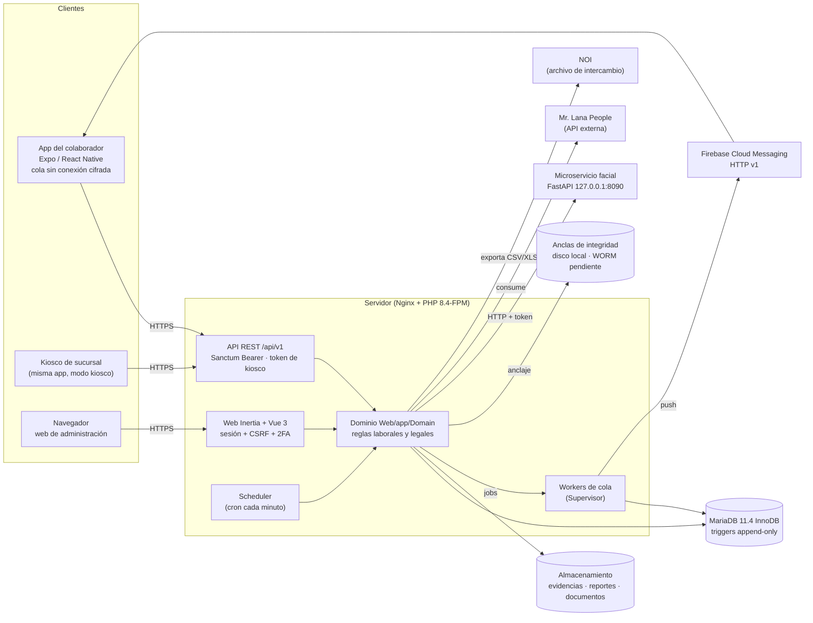
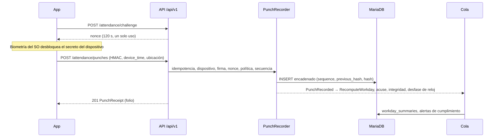

# Arquitectura — MR LANA Asistencias

## Vista general

Un solo backend Laravel (`Web/`) sirve la web y la API. Toda regla laboral, legal y de seguridad vive en `Web/app/Domain`. La app y la web sólo presentan información y capturan eventos. El contrato API compartido está en `packages/contracts/src/api.ts`.

## Contextos de dominio (`Web/app/Domain`)

| Contexto | Responsabilidad | Piezas clave |
|---|---|---|
| `Attendance` | Registro inalterable, firma de dispositivo, línea de tiempo reconocida, proyección diaria, omisiones, origen del marcaje, hora oficial, rectificaciones, integridad | `PunchRecorder`, `HashChain`, `DeviceSignature`, `EffectiveTimeline`, `WorkdayCalculator`, `Omissions`, `PunchOrigin`, `ClockSkewMonitor`, `RectificationService`, `IntegrityVerifier`, `IntegrityAnchorService` |
| `Signatures` | Firma electrónica del colaborador (NIP o biometría), convenio de registro y aviso de privacidad | `ElectronicSignatureService`, `SignaturePinService`, `RegistrationDocuments` |
| `Rectifications` | Parámetros del flujo: plazo de firma en días hábiles y cierre de nómina | `RectificationSettings` |
| `Legal` | Normativa versionada y cálculos legales puros | `LegalFramework`, `LegalParameters`, `LegalVersionManager`, `ShiftClassifier`, `WeeklyOvertimeCalculator`, `HolidayGenerator` |
| `Compliance` | Alertas legales, omisiones sin rectificar, monitoreo de integridad y aviso a RH/Sistemas | `ComplianceEvaluator`, `OmissionMonitor`, `IntegrityMonitor`, `StaffNotifier` |
| `Scheduling` | Turno programado por fecha y cambios de horario programados | `ScheduleResolver`, `ScheduledShift`, `ScheduleChangeService` |
| `Workforce` | Altas, bajas, movimientos, importación validada, alta de registro electrónico | `WorkforceService`, `EmployeeImportValidator`, `RegistrationStatus`, `ScheduleLegalValidator` |
| `Incidences` | Catálogo cerrado, evidencia y autorización por tipo, cancelación con motivo | `IncidenceCatalog`, `IncidenceService` |
| `Vacations` | Saldos con trazabilidad y solicitudes | `VacationService` |
| `Approvals` | Autorizaciones multinivel de incidencias (niveles según el tipo), vacaciones y horas extra, sin autoaprobación. Las rectificaciones tienen su propio flujo fijo de 5 pasos | `ApprovalWorkflow` |
| `Location` | Seguimiento por puesto durante la jornada y depuración legal de recorridos | `LocationTracking`, `LocationService`, `LocationRetention` |
| `Notifications` | Bandeja, acuse obligatorio de marcaje, comunicados, recordatorios y push FCM | `AnnouncementService`, `SendPunchReceipt`, `AttendanceReminders`, `Fcm/*` |
| `Reports` | Catálogo de 27 reportes, dataset único, PDF/XLSX/CSV, exportación NOI | `ReportCatalog`, `ReportDataset`, `ReportExporter`, `Noi/*` |
| `Security` | Permisos, roles, alcance (anti-IDOR), dispositivos, kiosco, 2FA, revisión de accesos | `PermissionCatalog`, `RoleStructure`, `AccessScope`, `DeviceService`, `DeviceIntegrityMonitor`, `KioskService`, `TwoFactorPolicy`, `UserAccessService` |
| `Organization` | Alta de organización y datos oficiales | `OrganizationProvisioner`, `OfficialCompanyData` |
| `Integrations` | Mr. Lana People: estructura, bajas e incidencias aprobadas | `People/*` |
| `Biometrics` | Verificación facial 1:1 con el microservicio open source | `FaceVerificationService`, `OpenSourceFaceProvider`, `UnavailableFaceProvider` |
| `Audit` | Bitácora append-only con valor anterior y nuevo | `AuditLogger` |
| `Dashboard` | Métricas del panel con alcance | `DashboardMetrics`, `PersonalSummary` |

## Multiempresa y alcance

- `CurrentOrganization` (por petición o job) se fija en el middleware `organization`.
- Todo modelo con `organization_id` usa `BelongsToOrganization` (scope global y asignación al crear).
- Spatie Permission con *teams* = `organization_id`. Roles y permisos: [Roles y permisos](../seguridad/ROLES_Y_PERMISOS.md).
- `AccessScope` restringe por sucursal asignada y por reportes directos del supervisor.
- Pruebas: `Web/tests/Feature/Domain/TenancyIsolationTest.php`, `RouteBindingIsolationTest.php` e IDOR en API y web.

## Modelo de datos (resumen)

Detalle de tablas, índices y triggers: [Base de datos](BASE_DE_DATOS.md).

- **Estructura**: `organizations`, `legal_entities`, `work_centers`, `branches` (registro patronal, geocerca, identificador de People), `departments`, `positions` (`location_tracking`), `organization_user`, `branch_user`, `organization_settings`.
- **Personal**: `employees`, `employments`, `employment_assignments` (vigencias), `attachments` (incluye convenio en papel, `category = registration_agreement`).
- **Horarios**: `schedules`, `schedule_segments`, `schedule_exceptions` (cambios de horario programados con autorización).
- **Asistencia** (append-only salvo proyecciones): `devices`, `kiosks`, `punch_challenges`, `attendance_punches` (`device_time`, `received_at`, `synced_at`, `kiosk_id`), `rectification_requests` (`stage`), `attendance_adjustments`, `electronic_signatures`, `integrity_anchors`, `workday_summaries` (recalculable).
- **Legal y operación**: `legal_versions`, `legal_version_revisions` (append-only), `holidays`, `incidence_types`, `incidences`, `vacation_*`, `overtime_records`, `compliance_alerts`, `approval_flows`, `approval_decisions`.
- **Documentos**: `policy_documents` (PDF versionado), `document_acknowledgements` (append-only).
- **Ubicación**: `location_points` (depuración legal programada).
- **Notificaciones**: `notifications`, `announcements`, `announcement_recipients` (`confirmed_at`).
- **Auditoría y otros**: `audit_logs` (append-only, `old_values`/`new_values`/`device_id`), `report_exports` (folio), `user_access_reviews`, `face_enrollments`, `face_verifications`, `integration_runs`.

## Flujo de un marcaje

Sin conexión: [Operación sin conexión](OPERACION_SIN_CONEXION.md). Kiosco: número de empleado + NIP de firma con token propio del kiosco.

## Flujo de una rectificación

Solicitud con evidencia → autorización del jefe inmediato → firma del colaborador en la app → validación de RH → ajuste aplicado (`attendance_adjustments`, encadenado). El marcaje original nunca cambia. Detalle: [Rectificaciones y firma](RECTIFICACIONES_Y_FIRMA.md).

## Procesos programados

Definidos en `Web/routes/console.php` (requiere `* * * * * php artisan schedule:run`). **Ninguno crea marcajes.**

| Comando | Frecuencia | Qué hace |
|---|---|---|
| `asistencias:cerrar-dia --dias=2` | Diario 01:15 | Recalcula jornadas, omisiones, horas extra y alertas |
| `asistencias:cerrar-dia --dias=1` | Cada 4 h | Re-evaluación intradía (turnos nocturnos) |
| `asistencias:festivos` | Día 1 de cada mes, 00:30 | Precarga art. 74 (año actual y siguiente) |
| `asistencias:integridad anclar` | Cada hora | Anclaje de cadenas |
| `asistencias:integridad diaria` | Diario 03:30 | Anclaje + verificación completa; alerta crítica si falla |
| `ubicacion:depurar` | Diario 02:45 | Depuración legal de recorridos vencidos |
| `cumplimiento:omisiones` | Diario 07:00 | Alertas de omisiones sin rectificar > 2 días |
| `asistencias:notificaciones --solo-comunicados` | Cada minuto | Comunicados programados |
| `asistencias:notificaciones --solo-recordatorios` | Cada 5 min | Recordatorios de entrada y salida pendientes (sólo avisan) |
| `rectificaciones:vencer` | Cada 15 min | Rechaza rectificaciones con plazo de firma vencido |
| `people:incidencias` | Cada hora | Incidencias aprobadas en People (si está configurado) |
| `asistencias:revocar-bajas` | Cada hora | Revoca app y dispositivos en bajas con fecha programada |
| `asistencias:revision-usuarios` | Diario 02:10 | Vence accesos de autoridad y abre la revisión trimestral |
| `model:prune` (desafíos) y `sanctum:prune-expired --hours=24` | Diario | Limpieza técnica |

Jobs en cola (`QUEUE_CONNECTION=database` por omisión): `RecomputeWorkday`, `GenerateReportExport`, `DeliverAnnouncement`, `SendPushToUser` y las notificaciones (`AppNotification`).

## Decisiones técnicas

| Decisión | Motivo |
|---|---|
| MariaDB con `DB_ENGINE=InnoDB` forzado | El servidor local de WAMP tenía MyISAM por defecto (error 1071, sin transacciones ni llaves foráneas). |
| Cadena con HMAC (no SHA-256 plano) | Quien tenga acceso a la BD no puede recalcular la cadena sin la clave, que vive fuera de la BD. Las anclas firmadas detectan reescrituras totales. |
| Triggers + trait `Immutable` | Defensa en profundidad: dominio y BD rechazan UPDATE/DELETE. Un DBA con privilegios totales puede desactivarlos; por eso existe la detección criptográfica. |
| Sin marcajes automáticos | Revisión RH: un marcaje que el colaborador no hizo invalida el registro (art. 132 fr. XXXIV). La salida faltante es omisión y sólo se corrige con rectificación firmada. |
| Rectificación = ajuste vinculado + firma | El registro hace prueba plena si fue acordado con el colaborador; sin firma no se aplica. |
| `is_super_admin` sin autorización operativa | Separación de funciones: Sistemas administra la plataforma, no la asistencia. |
| Descanso no registrado no se descuenta | LFT art. 64. |
| Tiempo extra registrado ≠ autorizado | Se conserva íntegro; la autorización es un acto aparte. |
| Versiones legales con checksum y verificación por RH | Reproducibilidad histórica y validación institucional explícita. |
| Hora oficial = recepción del servidor | La hora del dispositivo sólo se usa para capturas sin conexión y queda como declarada. |
| Dataset único por reporte | PDF, XLSX y CSV salen de los mismos datos y su SHA-256. |
